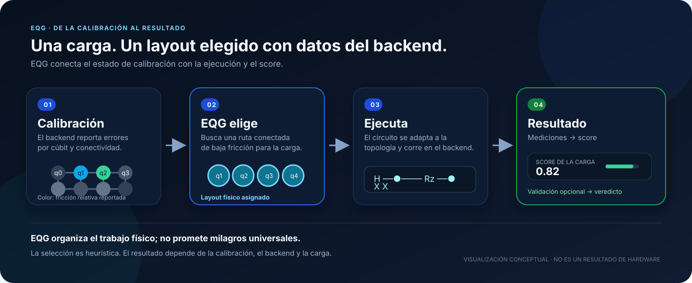

# EQG

**Una carga cuántica. Un layout físico elegido con datos del backend. Un score para entender el resultado.**

<p align="center">
  
</p>

<details>
<summary><strong>¿Qué está eligiendo EQG?</strong></summary>

Un backend tiene cúbits físicos conectados entre sí y cada uno reporta características de calibración. EQG usa esa información para elegir un layout conectado para la carga, en lugar de asignar los cúbits lógicos sin considerar el estado físico reportado.

La ilustración es explicativa: no representa una calibración ni una ejecución específica.

</details>

<details>
<summary><strong>¿Qué pasa durante la ejecución?</strong></summary>

EQG prepara el circuito para el backend y envía un trabajo. El proveedor ejecuta el circuito y devuelve mediciones; EQG calcula el score definido para la carga. El envío consume presupuesto del proveedor y puede esperar en cola.

La validación es opcional: compara el layout seleccionado con un layout de referencia y produce un veredicto según los umbrales configurados.

</details>

## Instalar

```bash
pip install .
```

## Python

Con un backend conectado y tu circuito preparado:

```python
from eqg import select_layout, run

layout = select_layout(backend, n=4)
result = run(backend, circuit, shots=2048, layout=layout)
print(result["score"])
```

El score incluido mide la razón de aproximación de MaxCut sobre un camino. Para otra función objetivo, usa las mediciones y calcula el score correspondiente.

## Ejecutar desde la terminal

Configura `IBM_QUANTUM_TOKEN` e `IBM_QUANTUM_INSTANCE` en el entorno, revisa `config/eqg.yaml` y habilita explícitamente `execution.confirm_spend: true` solo después de revisar el consumo.

```bash
run_eqg --config config/eqg.yaml
```

## Alcance

La selección es heurística y depende de la topología, la calibración disponible y la carga. EQG no garantiza una mejora universal ni elimina las colas del proveedor.

## Licencia

Elastic License 2.0. Consulta `LICENSE`.
